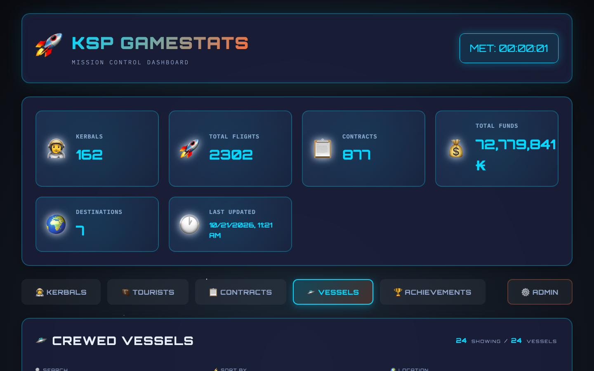
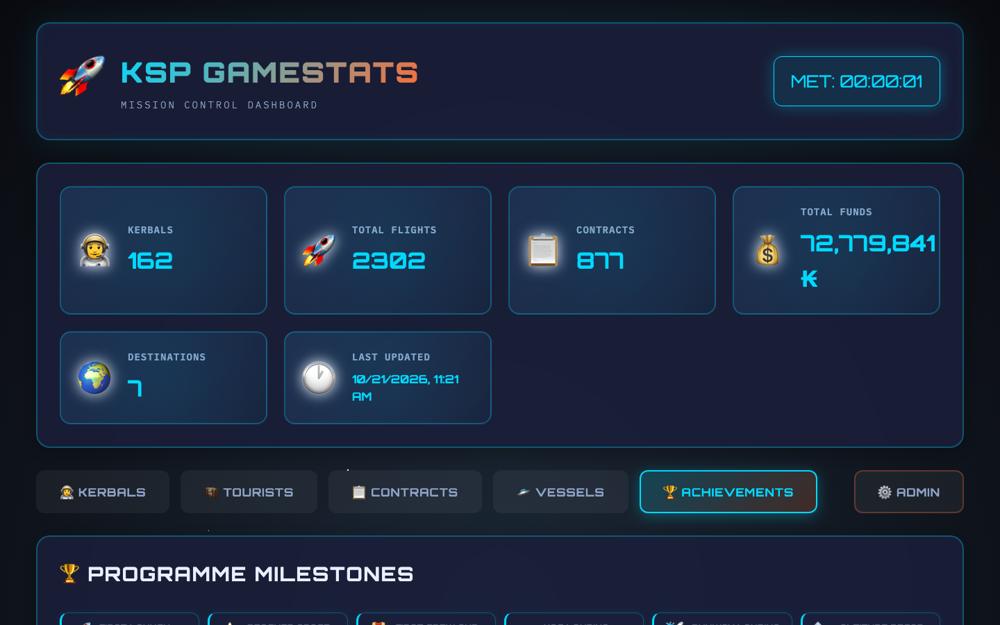

# KSP GameStats — Mission Control Dashboard

A browser-based statistics dashboard for **Kerbal Space Program** save files. Parses `persistent.sfs` and presents your career data in a space-themed UI — kerbals, tourists, contracts, crewed vessels, and world achievements, all in one place.


---

## Screenshots

**Kerbal Roster** — 162 kerbals sorted by star rating, with corps breakdown (Pilots / Engineers / Scientists, assigned vs available) and animated kerbal cards


**Kerbal Detail** — full profile modal with trait badge, star level, current mission and vessel (clickable → jump to vessel), join date, service time, courage/stupidity bars, and every destination visited


**Crewed Vessels** — all active crewed vessels with KSP type (Space Station, Surface Base, Spacecraft…), readable location ("Landed on Duna", "Orbiting Ike"), best crew ratings per trait, and crew pills — click any crew member to open their kerbal card



**Programme Milestones & Achievements** — global milestones (first launch, first orbit, first Mun landing…) with KSP date, crew, and vessel; body-by-body achievement grid showing reached, landed, flag planted



**Tourist Roster — Flying** — active tourists with contract objectives per celestial body; ✓ green = completed, ○ yellow = pending; 🏁 badge for fulfilled contracts awaiting recovery


**Contract Statistics** — mission summary tiles, cumulative earnings curve, and per-period activity bars


**Contract Drill-down** — click any contract type to open a modal with its own charts and top destinations


---

## Features

### Kerbal Roster
- Star rating (0–5★) computed from KSP XP with correct level thresholds
- Trait badges (Pilot / Engineer / Scientist), state (On Mission / Available / Dead)
- Missions flown, unique destinations, join date and service duration
- Corps summary bar: Pilots / Engineers / Scientists, assigned vs available
- Click any card to open the full kerbal detail modal

### Kerbal Detail Modal
- Current location and **vessel name** — click the vessel name to jump straight to the Vessels tab with that vessel highlighted
- Courage and Stupidity bars
- Every body visited, with visit count and XP tier

### Crewed Vessels Tab
- All vessels currently crewed, with:
  - **Vessel type** parsed directly from the save file (Space Station, Surface Base, Spacecraft, Spaceplane, Rover…)
  - **Readable location**: "Landed on Duna", "Orbiting Kerbin", "Splashed on Eve", "Sub-orbital over Kerbin", "Escaping Jool SOI"
  - Best Pilot / Engineer / Scientist level aboard
  - Full crew list as clickable pills — click any crew member to open their kerbal card
- Search by vessel name or crew name; sort by name, crew size, or best trait level; filter by location type

### Achievements Tab
- **Programme Milestones**: first launch, first orbit, first Mun landing, first flag, first crew recovery — with KSP in-game date, crew name, and vessel
- **Body Achievement Grid**: for every celestial body, shows which of reached / landed / flag planted have been accomplished (manned or unmanned)

### Tourist Roster
- **Flying / Awaiting**: active tourists with contract objectives per body; completed objectives in green, pending in yellow; 🏁 badge for fulfilled contracts awaiting recovery
- **Returned**: 600+ historical tourists grouped by contract mission with KSP date and agency

### Contracts Dashboard
- Mission summary tiles (total contracts, funds, passengers, top body)
- Cumulative earnings curve and per-period activity bars
- Click any contract type to open a drill-down modal with its own charts

### Technical
- **Incremental parsing** — MD5-based cache; unchanged saves skip the parser entirely; force-refresh available
- **Accurate visit counts** — mission-level deduplication: Flyby + Orbit + Land in the same mission = one visit
- **SQLite database** — stored in `~/.ksp-gamestat/`, survives updates; auto-migrates schema
- **Space-themed UI** — Orbitron / IBM Plex Mono, animated starfield, cyan / orange / green palette
- **Cross-navigation** — kerbal cards link to vessels; vessel crew pills link to kerbal cards

---

## Quick Start (macOS — browser mode)

The recommended way to run KSP GameStats on macOS is as a persistent background service accessible from any browser.

### 1. Install

```bash
git clone https://github.com/pinolallo/ksp-gamestat.git
cd ksp-gamestat
npm install --omit=dev
```

### 2. Deploy as a LaunchAgent (auto-start at login)

```bash
./deploy-mac.sh install
```

This installs a macOS LaunchAgent, starts the server at **http://127.0.0.1:4999**, and opens the dashboard in your browser. The service restarts automatically if it crashes and relaunches at every login.

### 3. Parse your save file

1. Open **http://127.0.0.1:4999** and click the **Admin** tab
2. Click **Scan Saves** — KSP GameStats will find all `persistent.sfs` files under `~/Applications/Kerbal Space Program/`
3. Select your career save and click **Parse**

### Deploy script commands

```
./deploy-mac.sh install     Install LaunchAgent and open browser
./deploy-mac.sh uninstall   Stop and remove the service
./deploy-mac.sh start       Start the service
./deploy-mac.sh stop        Stop the service
./deploy-mac.sh restart     Restart the service
./deploy-mac.sh status      Show PID, URL, health check
./deploy-mac.sh logs        Tail live log output
./deploy-mac.sh open        Open dashboard in browser
```

Logs are written to `~/Library/Logs/ksp-gamestat/`.

### Quick start without installing

```bash
npm run serve          # starts server at http://127.0.0.1:4999
# or
KSP_PORT=5000 node server/server.js
```

---

## Quick Start (Linux / Windows)

```bash
git clone https://github.com/pinolallo/ksp-gamestat.git
cd ksp-gamestat
npm install --omit=dev
npm run serve
# Open http://127.0.0.1:4999 in your browser
```

The default KSP save location varies by platform:

| Platform | Default save path |
|---|---|
| macOS (Steam) | `~/Library/Application Support/Steam/steamapps/common/Kerbal Space Program/saves/<name>/persistent.sfs` |
| macOS (direct) | `~/Applications/Kerbal Space Program/saves/<name>/persistent.sfs` |
| Windows (Steam) | `%ProgramFiles(x86)%\Steam\steamapps\common\Kerbal Space Program\saves\<name>\persistent.sfs` |
| Linux (Steam) | `~/.steam/steam/steamapps/common/Kerbal Space Program/saves/<name>/persistent.sfs` |

---

## Development Setup

### Requirements

- Node.js 18+
- npm

### Run in dev mode

```bash
git clone https://github.com/pinolallo/ksp-gamestat.git
cd ksp-gamestat
npm install
npm run serve
# Open http://127.0.0.1:4999
```

### Project structure

```
ksp-gamestat/
├── server/
│   ├── server.js       Express REST API (port via KSP_PORT env var)
│   ├── sfsParser.js    KSP .sfs save-file parser (state machine, no regex)
│   └── database.js     SQLite manager (better-sqlite3, auto-migration)
├── static/
│   ├── index.html      Single-page application shell
│   ├── app.js          Frontend logic (vanilla JS, no framework)
│   ├── styles.css      Space-themed CSS (Orbitron, IBM Plex Mono)
│   └── fonts/          Bundled fonts (works offline)
├── deploy-mac.sh       macOS LaunchAgent deploy / management script
├── package.json
└── LICENSE
```

---

## API Reference

| Method | Endpoint | Description |
|---|---|---|
| GET | `/api/health` | Health check |
| GET | `/api/config` | Current configuration (sfs path, parse status) |
| POST | `/api/config` | Set the `persistent.sfs` path |
| GET | `/api/scan-saves` | Auto-detect KSP save files on disk |
| POST | `/api/parse` | Parse the save file; supports `{"force": true}` |
| GET | `/api/summary` | Top-level stats (kerbals, flights, contracts, funds) |
| GET | `/api/kerbals` | All crew kerbals |
| GET | `/api/kerbals/:name` | Single kerbal with full location history |
| GET | `/api/tourists` | All tourists with state, objectives, location history |
| GET | `/api/contracts` | Contracts aggregated by type |
| GET | `/api/contracts/progress` | Progression timeline (optional `?type=` filter) |
| GET | `/api/vessels` | All currently crewed vessels with crew details |
| GET | `/api/achievements` | Programme milestones and per-body achievement grid |
| GET | `/api/system-info` | DB size and parse history |

---

## Troubleshooting

**Parse is slow** — files over 50 MB take 10–30 s on first parse. Subsequent parses skip unchanged files automatically (MD5 check).

**"No vessels found"** — the service may be running a stale version. Run `./deploy-mac.sh restart` to ensure the latest code is active.

**Port already in use** — `deploy-mac.sh start` automatically kills any stale process on the configured port before loading the LaunchAgent.

**Database issues** — delete `~/.ksp-gamestat/ksp_stats.db` and re-parse. The schema is recreated automatically with migrations for all new columns.

**Backend does not start** — run `npm install` to ensure `express`, `cors`, and `better-sqlite3` are installed.

---

## License

MIT — see [LICENSE](LICENSE) for details.

---

*May your Kerbals always make it home.*
