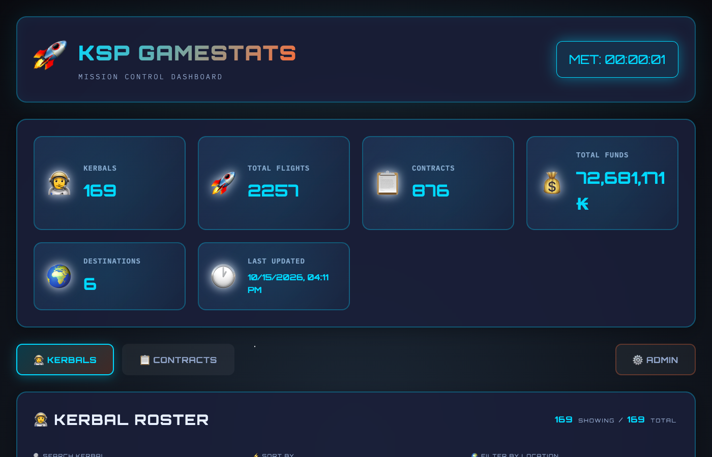
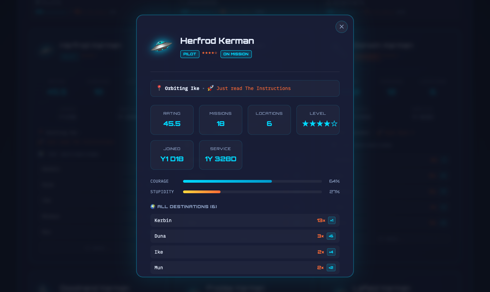
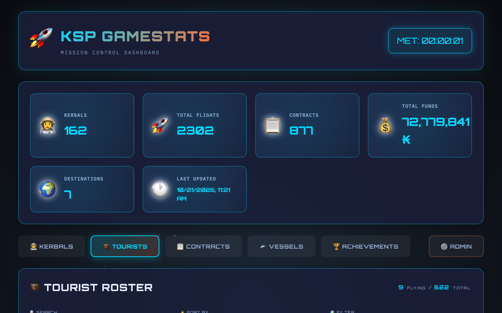
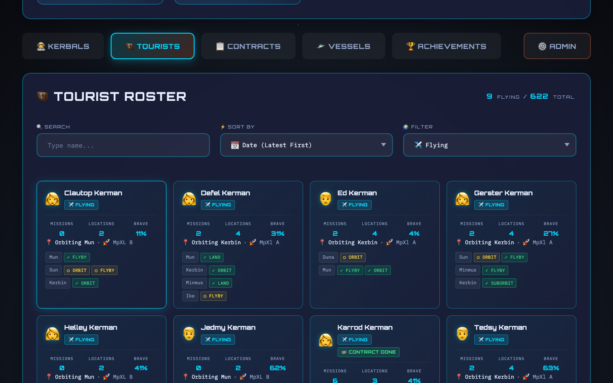
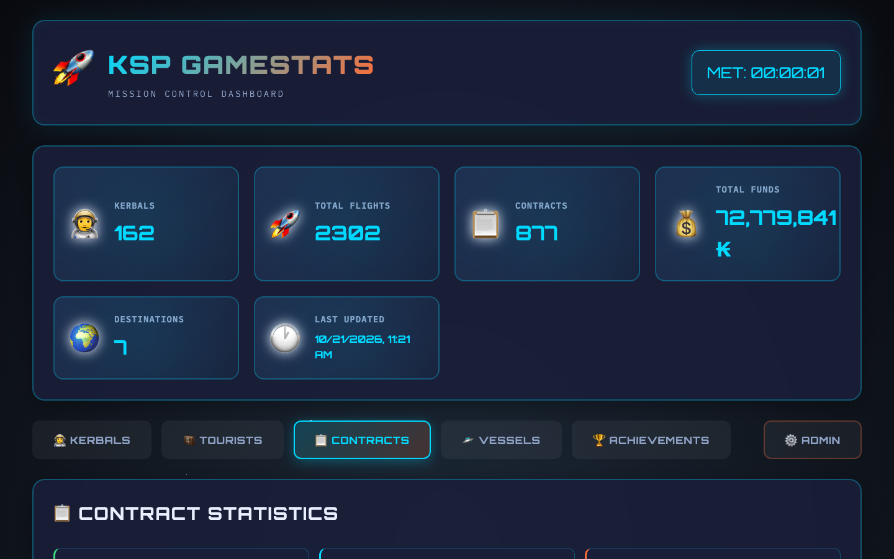
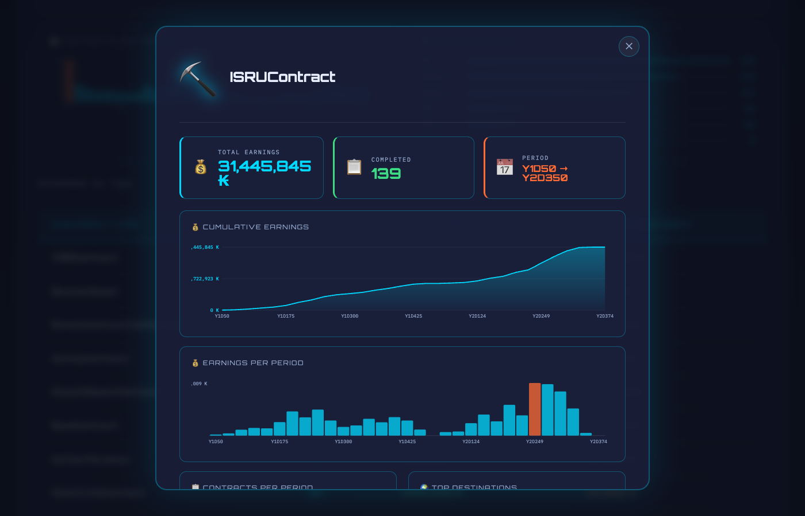

# KSP GameStats — Mission Control Dashboard

A desktop application for analysing and visualising Kerbal Space Program save-file statistics. Built with Electron + Python/Flask, it runs as a native app on macOS, Windows, and Linux — no Python installation required.


---

## Features

- **Kerbal Roster** — star rating (computed from KSP XP), trait badges, missions, locations, join date and service duration per kerbal; corps summary bar (Pilots / Engineers / Scientists, assigned vs available)
- **Tourist Roster** — live view of flying tourists with contract objectives and completion status per body; returned tourists grouped by contract mission with date and agency
- **Contracts Dashboard** — visual progression timeline: cumulative earnings, contracts per period, earnings per period, prestige breakdown, and top destinations
- **Contract Drill-down** — click any contract type to see its own filtered dashboard; TourismContract shows passenger counts instead of funds
- **Accurate Visit Counts** — mission-level deduplication: multiple events in the same mission (Flyby + Orbit + Land) count as one visit, not three
- **Incremental Parsing** — MD5-based cache avoids re-parsing an unchanged save file; force-refresh available
- **SQLite Database** — stored in the OS user-data directory, survives app updates
- **Space-Themed UI** — Orbitron/IBM Plex Mono fonts, animated starfield, cyan/orange palette
- **Native File Picker** — Browse for `persistent.sfs` without typing the path

---

## Screenshots

**Kerbal Roster** — summary stats, corps breakdown (Pilots / Engineers / Scientists assigned vs available), and crew cards sorted by star rating



**Kerbal Detail** — full profile with star level, join date, service time, courage/stupidity bars, and every body visited



**Tourist Roster — Flying** — active tourists with contract objectives per celestial body; ✓ green = completed, ○ yellow = pending; 🏁 badge for tourists whose contract is already fulfilled and awaiting recovery



**Tourist Roster — Returned** — 600+ historical tourists grouped by contract mission, with KSP date and agency



**Contract Statistics** — mission summary tiles, cumulative earnings curve, and per-period activity bars



**Contract Drill-down** — click any contract type to open a detailed modal with its own charts and top destinations



---

## Download

Pre-built installers are available on the [Releases](https://github.com/pinolallo/ksp-gamestat/releases) page:

| Platform | File |
|---|---|
| macOS (Apple Silicon) | `KSP-GameStats-*-arm64.dmg` |
| macOS (Intel) | `KSP-GameStats-*-x64.dmg` |
| Windows | `KSP-GameStats-Setup-*.exe` |
| Linux | `KSP-GameStats-*.AppImage` / `.deb` |

### macOS note (unsigned build)

The app is not signed with an Apple Developer ID. macOS Gatekeeper will block the first launch with a warning ("cannot be opened" or "contains malware"). This is a false positive — the binary is safe.

**Option A — Terminal (recommended):** run once after dragging to Applications:

```bash
xattr -rd com.apple.quarantine "/Applications/KSP GameStats.app"
```

Then double-click as normal.

**Option B — System Settings:** after a blocked launch, open **System Settings → Privacy & Security**, scroll down to the Security section, and click **Open Anyway** next to the KSP GameStats entry.

### Linux note

Make the AppImage executable after download:

```bash
chmod +x KSP-GameStats-*.AppImage
```

---

## Quick Start

1. Open the app and go to the **Admin** tab
2. Click **Browse…** (or type the full path) to select your `persistent.sfs` file — typically at:
   - **macOS**: `~/Library/Application Support/Steam/steamapps/common/Kerbal Space Program/saves/<save-name>/persistent.sfs`
   - **Windows**: `%ProgramFiles(x86)%\Steam\steamapps\common\Kerbal Space Program\saves\<save-name>\persistent.sfs`
3. Click **Configure**, then **Start Parsing**
4. Switch to the **Kerbals**, **Tourists**, or **Contracts** tab to explore your data

The database is stored automatically in:
- macOS: `~/Library/Application Support/ksp-gamestat/ksp_stats.db`
- Windows: `%APPDATA%\ksp-gamestat\ksp_stats.db`
- Linux: `~/.config/ksp-gamestat/ksp_stats.db`

---

## Development Setup

### Requirements

- Python 3.8+
- Node.js 18+
- npm

### Run in dev mode

```bash
# Clone
git clone https://github.com/pinolallo/ksp-gamestat.git
cd ksp-gamestat

# Python backend
python -m venv venv
source venv/bin/activate          # Windows: venv\Scripts\activate
pip install -r requirements.txt

# Node / Electron
npm install

# Build the backend binary (required before npm start)
npm run build:backend             # Windows: npm run build:backend:win

# Launch
npm start
```

The Flask server also runs standalone for browser-based development:

```bash
python app.py                     # Opens at http://localhost:4999
```

### Build installers

```bash
npm run build:mac     # macOS DMG (requires macOS)
npm run build:win     # Windows NSIS installer (requires Windows)
npm run build:linux   # Linux AppImage + deb (requires Linux)
```

### Project Structure

```
ksp-gamestat/
├── app.py                  Flask REST API (port configurable via KSP_PORT)
├── sfs_parser.py           KSP .sfs save-file parser
├── database.py             SQLite manager
├── requirements.txt        Python dependencies (Flask, flask-cors)
├── ksp_gamestat.spec       PyInstaller build spec
├── package.json            Electron + electron-builder config
├── electron/
│   ├── main.js             Electron main process: spawn backend, IPC, window
│   └── preload.js          Context bridge (native file picker)
├── build/                  App icons and macOS entitlements
├── .github/workflows/
│   └── build.yml           CI matrix: mac (arm64+x64), win, linux
└── static/
    ├── index.html          Single-page application
    ├── app.js              Frontend logic (vanilla JS, no framework)
    ├── styles.css          Space-themed CSS
    └── fonts/              Bundled Orbitron + IBM Plex Mono (offline)
```

---

## API Reference

| Method | Endpoint | Description |
|---|---|---|
| GET | `/api/config` | Current configuration |
| POST | `/api/config` | Set the `persistent.sfs` path |
| POST | `/api/parse` | Parse the save file (supports `{"force": true}`) |
| GET | `/api/summary` | Top-level stats (kerbals, flights, contracts, funds) |
| GET | `/api/kerbals` | All kerbals (tourists excluded) |
| GET | `/api/kerbals/<name>` | Single kerbal detail |
| GET | `/api/tourists` | All tourists with state, objectives, and location history |
| GET | `/api/contracts` | Contracts aggregated by type |
| GET | `/api/contracts/progress` | Progression timeline data (optional `?type=` filter) |
| GET | `/api/health` | Health check |
| GET | `/api/system-info` | DB size and parse history |

---

## CI / CD

GitHub Actions builds the app on every version tag (`v*`). Four runners produce native binaries for each platform; a draft GitHub Release is created automatically with all artifacts.

To publish a new release:

```bash
git tag v1.2.0
git push origin v1.2.0
```

Then review and publish the draft release on GitHub.

---

## Troubleshooting

**Parsing is slow** — files over 50 MB can take a minute or two on first parse. Subsequent parses skip unchanged files automatically.

**"File not found"** — use the absolute path to `persistent.sfs`; verify the file exists and is readable.

**Database issues** — delete `ksp_stats.db` from the user-data directory and re-parse. The schema is recreated automatically with migrations.

**Backend does not start (dev mode)** — make sure `npm run build:backend` completed successfully and `dist_pyinstaller/ksp-gamestat-server/` exists.

---

## License

MIT — see [LICENSE](LICENSE) for details.

---

*May your Kerbals always make it home.* 🚀
